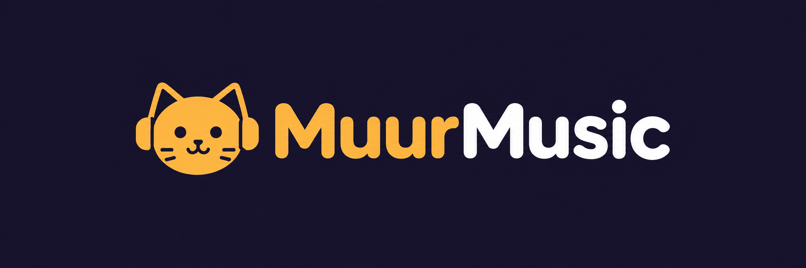

<p align="center"></p>

*Muur* (муур) means **cat** in Mongolian. MuurMusic is an ad-free hi-res music player for **Windows, macOS and iOS**. It is a personal replacement for Flacbox, with every Flacbox feature and none of its ads or limits. Website: [muur.app](https://muur.app).

## Features

- **Formats:** FLAC, ALAC, WAV, AIFF, DSD (DSF/DFF), APE, WavPack, MP3, AAC, Ogg, Opus, tracker music and more, up to 384 kHz.
- **Playback:** gapless, crossfade, ReplayGain, speed without pitch change, sleep timer, CUE sheets, bookmarks, an unlimited queue that is restored on launch.
- **Sound:** 10-band EQ with presets, effects, and a DSP chain builder with 22 node types. Windows also has WASAPI exclusive (bit-perfect) output.
- **Library:** auto-updating folders, smart search, tag editor, MusicBrainz lookup, smart playlists, M3U/M3U8/CUE import and export.
- **Sources:** SMB, WebDAV, FTP/SFTP, DLNA/UPnP, S3-compatible storage, Dropbox, Google Drive, OneDrive, Box, pCloud, Subsonic/Navidrome, Jellyfin/Emby, Plex, ZIP archives, and network discovery.
- **Offline:** downloads, an automatic audio cache, offline mode.
- **Extras:** synced lyrics (LRCLIB), a visualizer with a Cat Eyes preset, casting (AirPlay on Apple; Chromecast and DLNA on Windows), and system media controls. Apple also has widgets, CarPlay, Siri shortcuts and Wi-Fi transfer.

The full feature list is in [`docs/FEATURES.md`](docs/FEATURES.md). The file formats shared by both apps (EQ presets, DSP chains, smart playlists, source URIs, brand colors) are in [`docs/specs/SHARED_FORMATS.md`](docs/specs/SHARED_FORMATS.md).

## Repository layout

| Path | What |
|---|---|
| `windows/` | WinUI 3 app on .NET 10: `MuurMusic.Core`, `MuurMusic.Audio`, `MuurMusic.App`, plus tests. See [`windows/BUILD.md`](windows/BUILD.md) |
| `apple/` | One SwiftUI codebase for iOS 17+ and macOS 14+, the `MuurKit` Swift package, widgets, CarPlay. See [`apple/BUILD.md`](apple/BUILD.md) |
| `docs/` | Feature spec and shared formats |
| `assets/brand/` | Brand artwork; `python scripts/build_assets.py` regenerates the icon sets for each platform |
| `.github/workflows/` | CI: Windows build, test and publish; macOS package tests plus iOS and macOS app builds |

## Status

- **Windows:** builds with 0 warnings, and all 56 unit tests pass. The self-contained published folder launches correctly. CI uploads that folder as the `MuurMusic-win-x64` artifact.
- **Apple:** the code was written on Windows and is being finished on a Mac. It does not compile yet. See "Current status" in [`apple/BUILD.md`](apple/BUILD.md).

## Quick start (Windows)

```powershell
dotnet publish windows\src\MuurMusic.App\MuurMusic.App.csproj -c Release -r win-x64 --self-contained true -o publish\MuurMusic-win-x64
publish\MuurMusic-win-x64\MuurMusic.exe
```

Cloud sign-in (Dropbox, Google Drive, OneDrive, Box, pCloud) needs your own OAuth client IDs. Put them in `appsettings.Local.json` on Windows and `apple/Secrets.xcconfig` on Apple. Both files are git-ignored, and without them the other sources still work.
